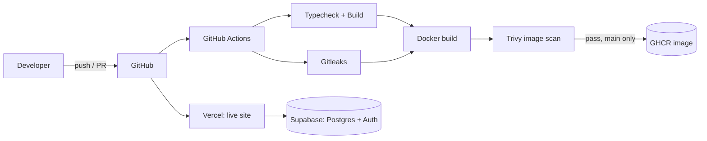

# ☕ D'Lingga Coffee — Reservation Platform


A full-stack table reservation system for a coffee shop (buka bersama / group bookings), with an admin panel, DP (deposit) payment flow, and server-side validation. Built as a real-world project **and** as a DevOps playground: containerized, scanned, and shipped by a CI pipeline.

🌐 **Live Website:** [bukber-dlingga.vercel.app](https://bukber-dlingga.vercel.app)

## ✨ What it does

- Multi-step booking wizard: pick date, table, and a **mix of menu packages** per reservation
- Prices and package rules **recalculated in the database**, never trusted from the client
- **Atomic double-booking prevention** for the same table and date
- Ticket lookup using Booking ID + WhatsApp number
- Admin panel: approve bookings, send DP 50% instructions (QRIS), confirm payment
- WhatsApp hand-off for booking and approval messages
- Reservation rules enforced in Jakarta local time

## 🛠️ Tech Stack

| Layer         | Technology                                              |
| ------------- | ------------------------------------------------------- |
| Frontend      | React, TypeScript, Vite, pnpm                           |
| Backend / DB  | Supabase (Postgres, RPC functions, Row Level Security)  |
| Auth          | Supabase Auth (admin role via `app_metadata`)           |
| Hosting       | Vercel (live site)                                      |
| Container     | Docker (multi-stage), Nginx unprivileged                |
| CI/CD         | GitHub Actions                                          |
| Security      | Trivy (image scan), Gitleaks, Dependabot                |
| Registry      | GitHub Container Registry (GHCR)                        |

## 🔐 Security & Data Design

- **Row Level Security:** the `anon` role can only create bookings, view occupied tables by date, and look up a ticket with a Booking ID + phone pair. It cannot list reservations or change status.
- **Admin enforced server-side:** RLS policies and database functions verify the admin role. Hiding the admin route in the frontend is not the only protection.
- **No privileged keys in the frontend:** only the public anon key is used; the `service_role` key is never exposed through `VITE_*` variables.
- **Versioned SQL migrations** in `supabase/migrations/` describe every schema change (reservation table, DP payment status, booking ID format, table capacity rules).
- **Privacy-aware Booking ID:** it contains customer details, so users are warned not to share tickets publicly.

## ⚙️ DevOps

### Architecture



### CI/CD pipeline

1. **test**: `pnpm install --frozen-lockfile`, `tsc --noEmit`, production build.
2. **secret-scan**: Gitleaks scans the full commit history.
3. **docker**: runs after `test` and `secret-scan` pass. It builds the image, scans it with Trivy (fails on fixable HIGH/CRITICAL findings), and pushes to GHCR only on `main`.
4. **Dependabot** opens weekly PRs for npm, Docker, and GitHub Actions dependencies.

### Run with Docker

```bash
cp .env.example .env        # fill VITE_SUPABASE_URL and VITE_SUPABASE_ANON_KEY
docker compose up --build
# open http://localhost:8080
curl http://localhost:8080/health
```

### Run without Docker

```bash
pnpm install
pnpm dev
```

### Technical decisions

- **Multi-stage build:** the final image contains only Nginx and the static build output, with no Node.js and no source code.
- **Non-root, locked-down runtime:** the container runs as a non-root user with a read-only filesystem, all Linux capabilities dropped, and `no-new-privileges` enabled.
- **Build-time config:** Vite inlines `VITE_*` values at build time, so they are passed as build args. Only public values (Supabase URL and anon key) are used; data safety comes from RLS.
- **SPA-aware Nginx:** fallback to `index.html` for client-side routes, long-lived caching for hashed assets, basic security headers.
- **Health endpoint:** `/health` backs the Docker `HEALTHCHECK`.
- **Quality gate before shipping:** an image is only pushed when typecheck, build, secret scan, and vulnerability scan all pass.

### Roadmap

- [x] Dockerfile, Nginx config, and docker-compose
- [x] CI pipeline with Gitleaks and Trivy
- [x] Dependabot
- [x] Publish image to GHCR
- [ ] Pin GitHub Actions to commit SHAs (supply-chain hardening)
- [ ] Lint and automated tests in CI
- [ ] Kubernetes manifests with Kustomize
- [ ] Terraform local cluster (kind) + Argo CD (GitOps)
- [ ] Observability with Prometheus and Grafana
- [ ] Automated Supabase migration checks in CI

## 🧰 Local Setup (app)

1. Create a Supabase project and run the SQL files in `supabase/migrations/` in order.
2. Copy `.env.example` to `.env.local` and fill in `VITE_SUPABASE_URL` and `VITE_SUPABASE_ANON_KEY`.
3. Create an admin user in Supabase Auth and grant the admin role through `app_metadata`.
4. `pnpm install && pnpm dev`

## 📬 Contact

- Email: rickyrohaendi1@gmail.com
- LinkedIn: [linkedin.com/in/ricky-rohaendi](https://www.linkedin.com/in/ricky-rohaendi/)
- GitHub: [github.com/rickyrohaendi12](https://github.com/rickyrohaendi12)
